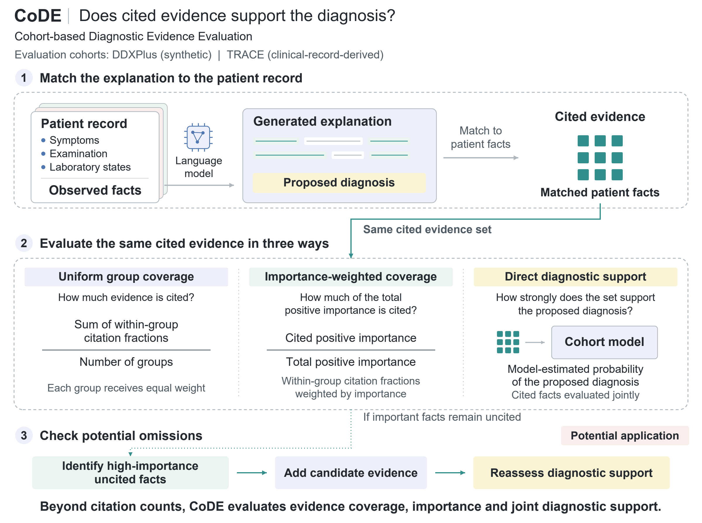

# CoDE: cohort-based diagnostic evidence evaluation

Code and aggregate results accompanying **CoDE: A Patient Cohort-Based Study of Evidence Coverage and Support in Diagnostic Explanations Generated by Large Language Models**, Bioengineering, manuscript bioengineering-4648980, accepted 4 November 2026.

CoDE matches cited evidence to observed patient facts and compares evidence coverage, importance-weighted coverage, and direct/referenced diagnostic support. The study separates evidence selection (RQ1), natural-explanation evaluation (RQ2), and controlled evidence subsets (RQ3).



## Quick start

Use Python 3.11 or 3.12. From this directory:

```bash
python -m venv .venv
# Linux/macOS: source .venv/bin/activate
# Windows: .venv/Scripts/activate
python -m pip install -r requirements/plots.txt
python scripts/verify_aggregates.py
python scripts/plot_paper.py
python examples/run_ddxplus.py
```

The DDXPlus example computes group coverage on four actual synthetic fact sets using the CoDE validator. Supplying official training/test CSVs also runs a small association-model fit and support calculation. The bundled fact sets come from a development fixture, separate from the paper's frozen 10,000-patient study cohort. The expected output is written to `build/ddxplus_example.json`. No clinical records, model endpoint or GPU are required.

`plot_paper.py` redraws the three main result figures and the selection heatmap from full-precision accepted aggregates. It also plots the exploratory DDXPlus effect distributions from anonymous synthetic-data effect arrays. The editable TRACE construction diagram is supplied as SVG alongside its accepted PDF. Replotting aggregate results preserves the reported estimates and intervals; cluster-bootstrap inference from individual records requires the original evaluation inputs.

## Contents

| Directory | Content |
| --- | --- |
| `tools/CoDE/src/code_eval` | Actual encoders, fitted-source adapters, coverage/support scores, selection and statistical functions |
| `tools/CoDE/scripts` | Actual fitting, RQ1–RQ3, sensitivity, calibration and second-generator entrypoints |
| `tools/CoDE/tests` | Constructed-fixture contract tests |
| `tools/CoDE/configs` | Experiment settings and frozen-input checks |
| `results/aggregate` | Accepted shareable comparison matrices |
| `results/figure_inputs` | Full-precision aggregate plotting inputs and anonymous DDXPlus effect arrays |
| `results/paper_tables` | Accepted main/Supplementary table cell matrices, retaining LaTeX mathematical notation |
| `figures/accepted` | Final figure PDFs and editable construction SVG |
| `examples` | Public DDXPlus miniature and scoring example |
| `upstream/TRACE_processing` | Accepted LANTERN source-processing, original 4B rollout and full-text matching code |
| `docs/paper_artifact_map.csv` | Every main/Supplementary figure and table mapped to results and implementation |

## Full experiments

See [experiment instructions](docs/EXPERIMENTS.md), [input contracts](docs/INPUT_CONTRACTS.md), and [TRACE methods](docs/TRACE_PROCESSING.md). The upstream source-processing supplement is included under `upstream/TRACE_processing`; its README gives source-stage commands. `export_trace_lantern_handoff.py` connects the accepted CoDE view to the original generation input. The historical entrypoint names are retained to identify the implementations used for each accepted result. Machine-specific path defaults have been replaced by local paths; adaptations are listed in `docs/release_adaptations.json`.

Full fitting/evaluation uses NumPy, SciPy, LightGBM, PyTorch, scikit-learn and Pydantic. Local text generation additionally uses Transformers and an OpenAI-compatible local model service. Install `requirements/experiments.txt` for model experiments. Generation drivers use Linux process/file-lock facilities and are intended for Linux servers. Use a CUDA-compatible PyTorch build appropriate to your machine.

Training uses training partitions; development data select/calibrate the specified settings. Saved-input/model identity checks remain active. The original model checkpoints and full frozen study inputs are not bundled. Restoring an experiment requires the matching input manifests and trained artifacts; changing a digest to bypass a failed identity check changes the reproducibility contract.

## Access and licensing

DDXPlus is a public synthetic dataset. Its example records retain their original [CC BY 4.0 attribution](examples/DATA_SOURCE.md). TRACE derives from MIMIC-IV-Ext Clinical Decision Making and remains subject to PhysioNet credentialing and the project data-use agreement. This release includes processing/evaluation code, schemas and aggregates; clinical notes, patient-linked explanations, citation sets, identifiers and checkpoints are excluded. See [data access](docs/DATA_ACCESS.md).

This is a local release candidate. The authors/institution must select the license for their own code before public posting; `LICENSE_PENDING.md` records this decision. Existing SIS, Anchors and TabR licenses remain in force. A repository URL and final bibliographic DOI can be added when assigned; neither is assumed here.

See `docs/VALIDATION.md` for the checks actually run on this package.
